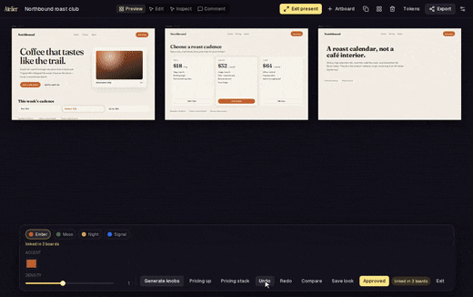
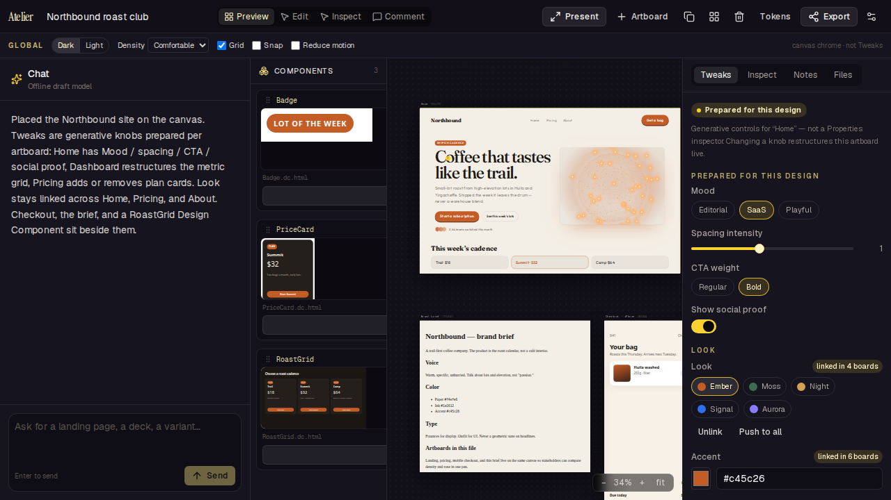
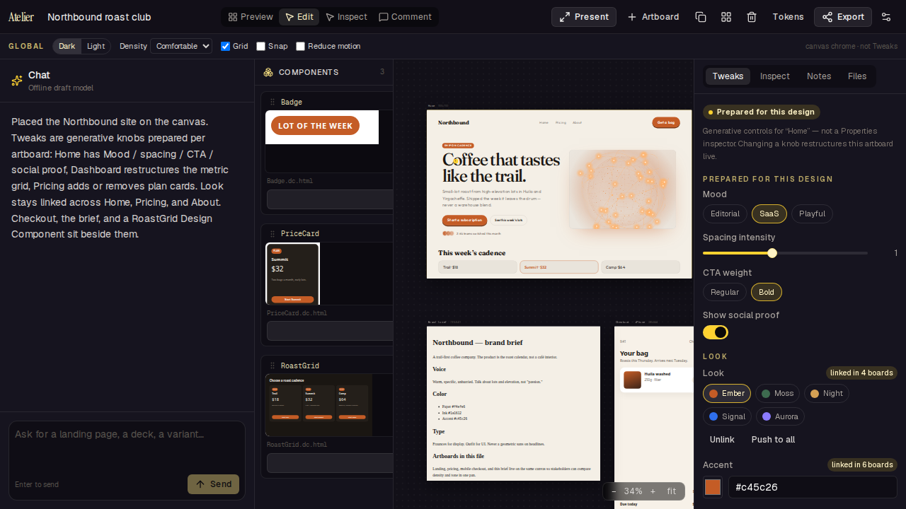
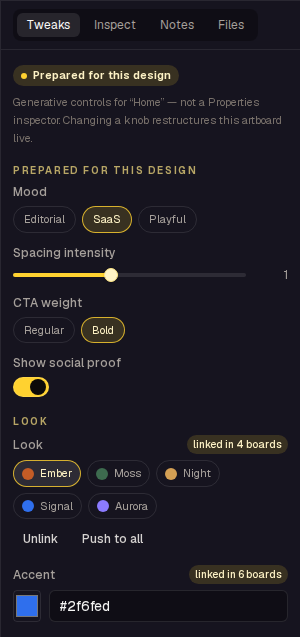
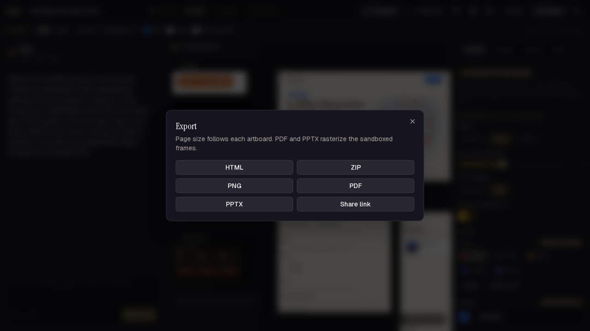
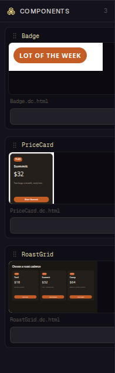
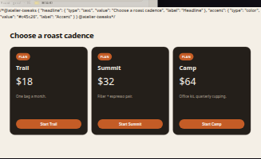
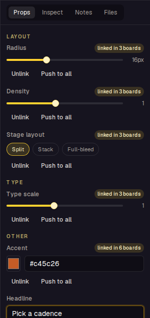

# Atelier

[](LICENSE)
[](https://nextjs.org/)
[](https://www.typescriptlang.org/)
[](#quick-start)

**Open-source Claude Design / Claude Artifacts alternative** — chat on the left, infinite pan/zoom multi-artboard canvas on the right. Generate HTML, React, SVG, Markdown, and Mermaid; pre-build live **Tweaks**; pin comments; export HTML / ZIP / PDF / PNG / PPTX. MIT-licensed, self-hostable Next.js app with bring-your-own-key (BYOK).

[English](README.md) · [简体中文](README.zh-CN.md) · [Comparison](docs/COMPARISON.md) · [Architecture](docs/ARCHITECTURE.md) · [Design Components](docs/DC-PROTOCOL.md)



Atelier is a standalone product inspired by the *shape* of Claude Artifacts and Claude Design (chat + live canvas + isolated iframes + tweaks). It does **not** copy Anthropic prompts, trademarks, or source.

## Why Atelier

| Need | What you get |
| --- | --- |
| Claude Design–style studio without lock-in | MIT, self-host, no Anthropic account required for the demo |
| Multi-page review | Project-level **linked Tweaks** — change a look or move Pricing once; Home / Pricing / About update together |
| Real HTML artboards | Sandboxed opaque-origin iframes, streaming `<artboard>` render, Edit / Inspect / Comment |
| Reusable design pieces | Original `.dc.html` Design Components protocol (props, slots, `<dc-import>`) |
| Your models | BYOK: Anthropic, OpenAI, OpenRouter, or any OpenAI-compatible base URL |

Full matrix: [docs/COMPARISON.md](docs/COMPARISON.md).

## Features

- **Studio layout** — resizable chat, infinite canvas, tweaks / inspect / comments / files rail
- **Multiple artboards** — add, duplicate, drag, arrange; layout persisted in the project
- **Opaque-origin iframes** — `sandbox="allow-scripts"` without `allow-same-origin`; typed postMessage protocol with per-board nonces
- **Streaming render** — `<artboard>` tags land on the canvas while the model is still writing
- **Self-check** — iframe errors trigger one auto-fix turn
- **Direct manipulation** — Edit / Inspect / Comment modes inside the frame
- **Tweaks** — generative knobs prepared **for that design**, not a CSS inspector. The agent (or **Generate knobs**) emits mood / plan count / metric density / show-hide blocks that restructure layout and copy live. A project-level theme + shared sections still bind **every** page: change Moss once and Home, Pricing, and About update together (`linked in N boards`). **Apply across canvas** copies the active palette. Unlink a board to override; **Push to all** writes it back. Global canvas toggles (theme / density / grid / snap / reduce motion) stay separate. **Present** is a locked-camera dock, Compare A|B, undo, **Approved**. No regenerate.
- **Design Components** — `.dc.html` files with typed props, slots, `<dc-import>` composition, cycle detection, library + drag onto canvas, `dc-write` / `dc-set-props` agent tools, flatten on export. Spec: [docs/DC-PROTOCOL.md](docs/DC-PROTOCOL.md)
- **Pinned comments** — queued into the next turn; the agent resolves them by id
- **Project files + history** — versions snapshot after each generation
- **Optional design-system extract** — image palette, URL CSS, or GitHub repo
- **In-artifact AI** — `window.artifact.complete(prompt)` proxied through the host
- **Export** — HTML, ZIP (`canvas.json`), PDF (page size from the artboard), PNG, PPTX, share link
- **BYOK** — Anthropic, OpenAI, OpenRouter, or any OpenAI-compatible base URL; keys in `localStorage` or server env

## Screenshots

| Canvas | Edit mode | Tweaks | Export |
| --- | --- | --- | --- |
|  |  |  |  |

| Component library | Composed DC | Instance props |
| --- | --- | --- |
|  |  |  |

Hero user-story 8s GIF (520px / 12fps, three palettes + Compare + Approved): [docs/media/tweaks-v4.gif](docs/media/tweaks-v4.gif) · full walkthrough [docs/media/tweaks-v4.mp4](docs/media/tweaks-v4.mp4). v3 (linked pages + Pricing up): [docs/media/tweaks-v3.gif](docs/media/tweaks-v3.gif). v2: [docs/media/tweaks-v2.gif](docs/media/tweaks-v2.gif). v1: [docs/media/tweaks-v1.gif](docs/media/tweaks-v1.gif). Story: [docs/media/story/story-tweaks.md](docs/media/story/story-tweaks.md). Maya / Saturday cupping (archive): [docs/media/feature-8s.gif](docs/media/feature-8s.gif) · [docs/media/demo.mp4](docs/media/demo.mp4). Straight demo: [docs/media/demo-straight-8s.gif](docs/media/demo-straight-8s.gif). Longer DC walkthrough: [docs/media/dc-demo.webm](docs/media/dc-demo.webm).

## Quick start

```bash
npm install
npm run dev          # http://127.0.0.1:43173
```

Open the **Northbound** demo from the landing page. Chat works without a key (local draft model). For a real model, click the gear and paste an API key, or set env:

```bash
ANTHROPIC_API_KEY=sk-ant-...
# or OPENAI_API_KEY=...
# or OPENROUTER_API_KEY=...
```

```bash
npm test             # Vitest: protocol, tweaks, parse, export, design components
npx playwright install chromium
npm run test:e2e     # Playwright + screenshots in docs/screenshots and e2e/artifacts
npm run build
```

## Deploy

Any Node host that can run Next.js 16:

```bash
npm run build
npm start -- --port 43173
```

Or import the repo into Vercel. Set `ANTHROPIC_API_KEY` / `OPENAI_API_KEY` / `OPENROUTER_API_KEY` if you want a server-side default; otherwise each user pastes a key in Settings.

Share links write JSON under `.data/shares/` — mount a persistent volume in production, or swap the store.

## Docs

| Doc | Topic |
| --- | --- |
| [docs/COMPARISON.md](docs/COMPARISON.md) | Atelier vs Claude Artifacts vs Claude Design |
| [docs/ARCHITECTURE.md](docs/ARCHITECTURE.md) | Agent loop, canvas, iframes, server proxy |
| [docs/DC-PROTOCOL.md](docs/DC-PROTOCOL.md) | Design Components (`.dc.html`) protocol |

Short architecture version: the browser owns the agent loop and the canvas; iframes are opaque; the Next.js server only proxies tokens and stores share snapshots.

## Cite

If you use Atelier in research or writing, see [CITATION.cff](CITATION.cff).

## License

[MIT](LICENSE) — Copyright (c) 2026 Atelier contributors
